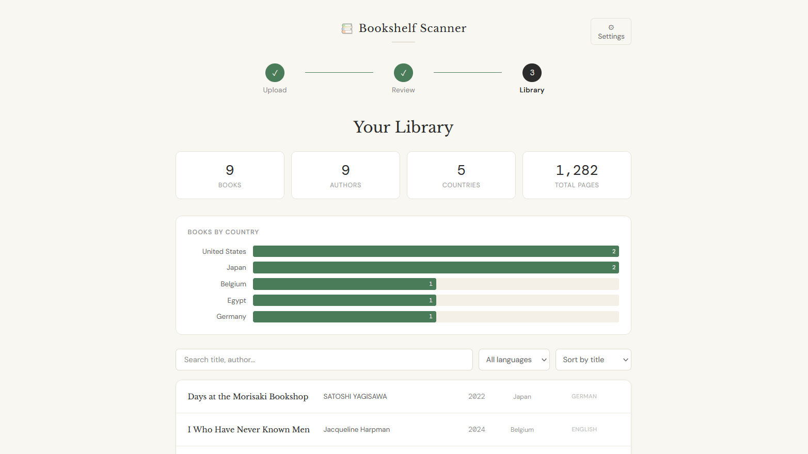
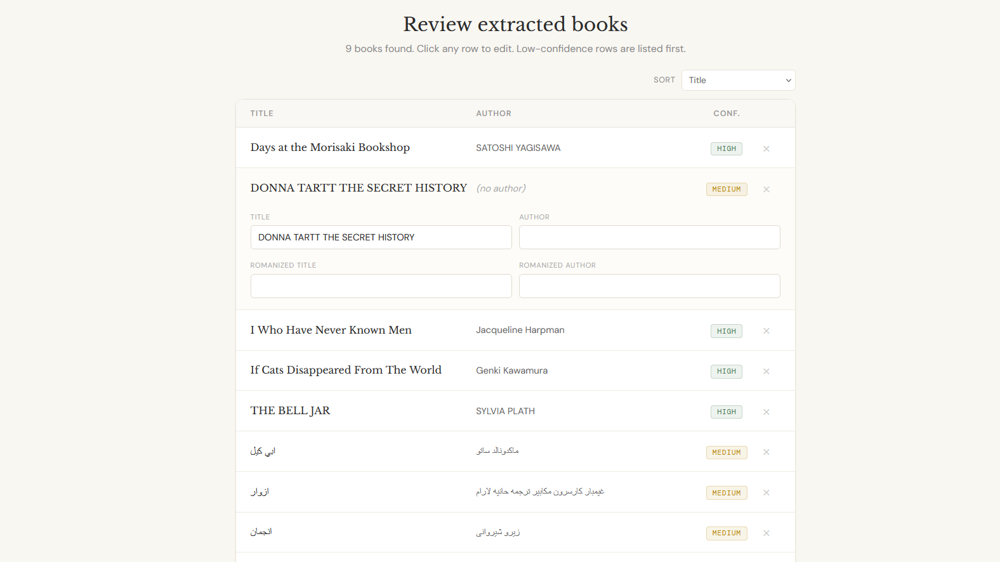
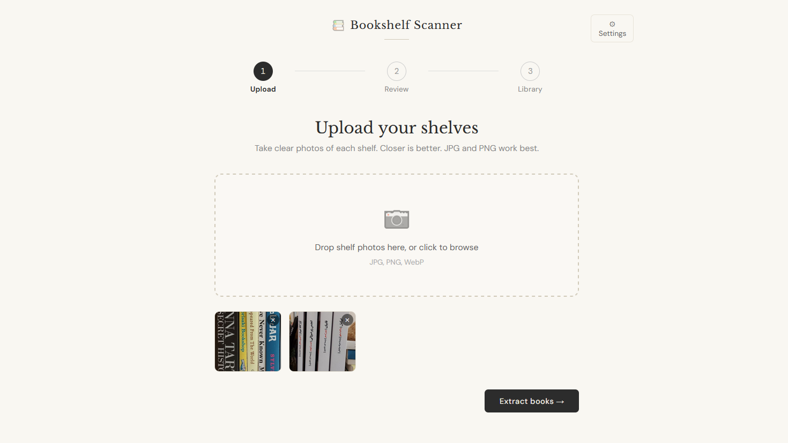

# Bookshelf Scanner 📚

A small web app that turns photos of your bookshelves into a structured, searchable catalog. Point your phone at a shelf, upload the photos, and the app extracts every title using a vision model, fills in metadata, and saves the result locally.

Built to handle multilingual libraries, with particular attention to Persian/non-Latin script.




## The problem

I have a few hundred books across two languages and no catalog. I want to be able to answer simple questions about my library: how many Iranian authors do I own, what decade are most of these from, which languages are over-represented. Manually entering each title into a spreadsheet is tedious, and existing barcode-scanning apps miss most Persian-language editions entirely (no ISBN, no barcode, or simply not in their database).

## The solution

Upload photos of your shelves. The app does three things:

1. **Reads the spines** with a vision-language model (Google's Gemini Flash on the free tier by default) and returns each book in both the original script and a romanization, with a confidence score.
2. **Lets you review** the results in an editable table, sorted with the least-confident readings first, so you fix only what needs fixing.
3. **Finds each book's English identity and fills in metadata.** Persian titles are looked up on Wikidata (falling back to the text model) to find the English title they are catalogued under; then Open Library supplies year, pages, ISBN and cover image, with an LLM fallback for fields the API doesn't reliably return (author's country of origin, in particular), then gives you a second review pass before saving.

The final catalog lives in your browser's IndexedDB and can be exported to CSV or JSON whenever you want.

## Screenshots

**Library view.** Searchable, sortable catalog with per-country breakdown and CSV/JSON export.


**Review step.** Extracted books are shown in an editable table sorted by confidence so the rows most likely to need a human eye come first.



**Upload.** Drag and drop shelf photos, then trigger extraction.



## Getting started

You need Node.js 18 or higher and a free [Google AI Studio API key](https://aistudio.google.com/apikey) (no card needed). Gemini Flash reads both the photos and the text on the free tier.

The Vite dev server forwards model calls to the provider (see `vite.config.js`), so run the app with `npm run dev` (or `npm run preview` after a build); a plain static host would not work. Free tiers are rate-limited; the app waits and retries when the provider asks it to slow down.

Two other providers are available in Settings: Z.ai (free GLM-4.6V-Flash and GLM-4.7-Flash, but often overloaded) and HuggingFace (Qwen3.5-397B-A17B, paid inference credits).

To check that the models answer with your key before scanning: `GEMINI_API_KEY=... npm run check-models -- path/to/shelf.jpg` (in PowerShell: `$env:GEMINI_API_KEY="..."` first). Add `--model <id>` to try another model, `--list` to see the models your key can use, or `--provider zai` (with `ZAI_API_KEY`) to check another provider.

```bash
git clone https://github.com/MahshadSa/bookshelf-scanner.git
cd bookshelf-scanner
npm install
npm run dev
```

The app opens at `http://localhost:3000`. On first launch it asks you to paste your API key, which is stored locally in IndexedDB and never sent anywhere except the provider it belongs to.

That is the whole setup. No backend, no database, no Python.

## How it works

```
Shelf photos
    -> Vision model (extractor.js)        # reads spines, returns JSON
    -> Fuzzy dedup (text.js)              # script-aware, handles ZWNJ / Arabic-vs-Persian
    -> Human review (ReviewScreen.jsx)    # fix the rows that need fixing
    -> English title (wikidata.js)        # Wikidata, then text model, for non-Latin titles
    -> Open Library + LLM fallback        # validated, relevance-checked metadata
    -> Metadata review                    # inspect sources and edit before saving
    -> IndexedDB (library.js)             # persistent local catalog
    -> Dashboard / search / export
```

### Project structure

```
bookshelf-scanner/
├── index.html
├── package.json
├── vite.config.js
└── src/
    ├── App.jsx                         # state machine: Upload -> Review -> Library
    ├── main.jsx                        # entry point
    ├── index.css                       # global styles + Persian font fallback
    │
    ├── api/
    │   ├── extractor.js                # vision model call, JSON parsing, batch dedup
    │   ├── enricher.js                 # English title, Open Library + LLM fallback
    │   └── wikidata.js                 # Persian title -> English title, year, language
    │
    ├── components/
    │   ├── ui.jsx                      # Button, ConfidenceBadge, Stepper, ProgressBar
    │   ├── UploadScreen.jsx            # drag-and-drop, file list
    │   ├── ReviewScreen.jsx            # editable table sorted by confidence
    │   ├── LibraryScreen.jsx           # stats, search, sort, filter, export
    │   └── SettingsModal.jsx           # API key, model choice
    │
    └── lib/
        ├── text.js                     # normalization, similarity, fuzzy dedup
        ├── validation.js               # external-data validation and coercion
        ├── http.js                     # cancellable requests with timeouts
        ├── llm.js                      # chat call, 429 retries, JSON parsing
        ├── providers.js                # Gemini / Z.ai / HuggingFace config, settings migration
        └── library.js                  # IndexedDB persistence, CSV/JSON export
```


## Tech stack

| Layer | Choice | Why |
|---|---|---|
| Framework | React 18 + Vite | Fast dev loop, no build configuration to maintain |
| Vision | Gemini Flash (free tier), GLM-4.6V-Flash via Z.ai (free), or Qwen3.5-397B-A17B via HuggingFace (paid) | Free tiers keep a personal tool free; Gemini reads Persian script well and is the most dependable of the free options; photos are scaled to 3072 px before upload |
| English titles | Wikidata | Free, no key; matches Persian titles directly and returns the English label, year and original language |
| Metadata API | Open Library | Free, no key, reasonable coverage for English books |
| Metadata fallback | Gemini Flash (free tier), GLM-4.7-Flash via Z.ai (free), or the HuggingFace model | Fills gaps the API doesn't cover, especially author nationality for Persian authors |
| Storage | IndexedDB (via [`idb-keyval`](https://github.com/jakearchibald/idb-keyval), ~600 bytes) | The data lives on one device; a real database would be ceremony |
| Dedup | Normalized-key matching | Handles ZWNJ, tatweel, and Arabic-vs-Persian character variants |

## Multilingual support

The pipeline is designed for mixed-language libraries. A few specific decisions matter:

- **Both scripts are kept.** The vision model returns each title and author in the original script *and* a romanization. The original script is what you'd want to see in your catalog; the romanization is what Open Library can actually find.
- **Persian/Arabic normalization** runs before search and before deduplication. Persian and Arabic share characters that look identical but have different Unicode code points (Persian ya `ی` U+06CC vs Arabic ya `ي` U+064A, kaf `ک` vs `ك`). Spine text mixes them and so do API indexes, so both sides are normalized to Persian forms. ZWNJ and tatweel are stripped, alef variants folded.
- **The fallback retries with the original script** if the romanized search returns nothing, which sometimes works for less common Persian publishers that Open Library indexes by Persian text.
- **English titles bridge the catalogue gap.** Open Library files Persian classics and translations under their English titles ("The Blind Owl", not "Boof-e Koor"). Wikidata maps Persian titles to English ones; a candidate is accepted only if its author matches the spine, which filters out films and species with the same name. When Wikidata has no match, the text model suggests one, and its suggestion is marked as such in the review step.
- **Work facts and edition facts are kept apart.** A match found through the English title describes the work, not the Persian copy on your shelf, so only the year and genre are taken from it, never the pages, ISBN or cover of an English edition.
- **The body font has an Arabic/Persian fallback** so the original-script titles render properly even when the primary serif/sans stack doesn't include those glyphs.

## Design decisions

**Vision model over classical OCR.** A traditional pipeline (spine segmentation, perspective correction, OCR engine, text parsing) takes serious engineering to get right for each edge case. A VLM handles rotated text, partial occlusion, decorative fonts, and mixed scripts in one call. The tradeoff is API dependency, but for a personal tool processing ten images at a time this is the right balance.

**Human-in-the-loop is architectural, not optional.** Vision-model confidence on Persian calligraphic spines drops, and the downstream enrichment is only as good as the title and author it gets. A fast editable table with low-confidence rows surfaced first lets the user fix the 10% that matters without re-reading the 90% that's correct. The confidence is shown as three buckets (high/medium/low), not a precise percentage, because the model's self-report is not a calibrated probability.

**No backend.** An earlier version had a FastAPI server doing the same work. For a single-user local tool, that meant two processes to run, Python to install, and twice as much code to maintain. The vision model and Open Library are both HTTPS APIs that work fine from the browser; IndexedDB handles persistence; the simplification was worth more than the architectural separation. (Caveat: this means the API key lives in the browser. That's fine for a tool you run on your own machine; it would not be fine if this were deployed publicly.)

**Layered enrichment.** Wikidata gives the original year and language of known works; Open Library is reliable for year, pages, and ISBN but rarely returns author nationality. Rather than leaving fields blank, the enricher asks the text model to fill any specific gaps the sources left, per-field. This catches author country (the field Open Library is worst at) without overwriting good API data with model guesses. The model is not asked for page counts, which depend on the edition in hand.

**Genre as a controlled vocabulary.** Open Library `subject` arrays contain things like "Accessible book" and "Internet Archive Wayback Machine" alongside actual genres. A keyword map normalizes these to a small fixed set (Fiction, Non-fiction, History, etc.) so the dashboard doesn't get cluttered.

## Known limitations

- HEIC images from iPhone exports aren't supported yet; export as JPG before uploading.
- The API key lives in browser storage, which is fine for a local tool but not safe to deploy publicly without proxying through a server.
- Vision-model accuracy on decorative Persian calligraphic spines drops to around 80 to 85 percent; the review step exists specifically because of this.
- Open Library has thin coverage for many Persian publishers, which is why the LLM fallback exists.

## Roadmap

- [ ] Cover image thumbnails in the library list
- [ ] Reading status (read / unread / in progress) with notes
- [ ] HEIC support via client-side conversion (iPhone exports)
- [ ] Decade and language breakdowns alongside the country chart
- [ ] Back up / restore the library via JSON import


## Project history

The initial version split this into a Python/FastAPI backend and a React frontend. For a single-user local tool, that meant two processes to run, Python as an installation dependency, and the same logic duplicated in both languages. The current version removes the backend entirely, moves persistence to IndexedDB, and consolidates the pipeline into the frontend. The code is now about the same length but does roughly twice as much, with one process to maintain.

The JavaScript and Node.js implementation was developed with Claude Opus 4.7 (Anthropic) as a coding assistant for syntax, boilerplate, and debugging. The overall system design, pipeline architecture, and decisions around model selection, multilingual handling, and two-tier enrichment were made independently.

## Tests

Run the focused normalization, deduplication, and response-validation tests with:

```bash
npm test
```

## License

MIT
